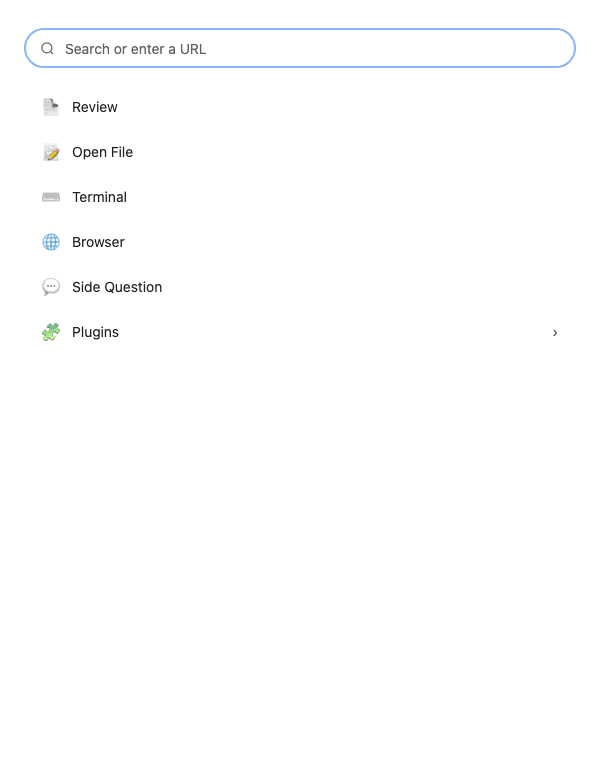

# Hugo Preview — Antigravity MCP App

An [Antigravity MCP App](https://antigravity.google/docs/mcp-apps/) plugin that lets you start/stop a local `hugo server`, browse recent and upcoming blog posts, preview them live, and edit Markdown side-by-side directly inside Antigravity's **Side Panel (`aux_pane`)**.

---

## Main Use Cases

1. **One-Click Local Hugo Lifecycle**: Start and stop your local `hugo server` directly from Antigravity's side panel with `--buildDrafts` (`-D`) and `--buildFuture` (`-F`) enabled by default (and toggleable anytime). No separate terminal needed—and the server cleans up automatically on exit.
2. **Browse Recent, Upcoming & Older Posts**: Open the panel to see your 10 most recent and scheduled posts (with `DRAFT` and `FUTURE` badges), filter across your entire blog in real time, or pick any older post from the **Older Posts** dropdown. Clicking any post starts Hugo automatically if it isn't running yet.
3. **Live Post Preview (Desktop & Mobile)**: Inspect how your Hugo post renders in real time alongside your conversation, toggle a mobile viewport width (`📱`), pop the page out into your browser (`↗`), or inspect live Hugo build logs and errors (`Logs`).
4. **Split-View Markdown Editing with Bidirectional Smooth Scroll & Live Reload**: Switch to **Split** mode to edit a post's `.md` source on top while watching Hugo live-reload the rendered post underneath. Drag the divider to adjust the split height (double-click to reset). Includes always-on **auto-save** (1s after you stop typing, or `Cmd/Ctrl+S` immediately), Tab indentation, and **bidirectional smooth scroll sync** (scrolling Markdown smoothly scrolls the preview and vice versa).
5. **Agent-Driven Previews**: Ask your Antigravity agent to *"open Hugo Preview"*, *"list my draft or future posts"*, or *"preview my latest post"*—the agent can start Hugo and steer the side panel straight to a specific post while you edit together.

---

## Demo



---

## MCP Tools

| Tool | Visibility | Description |
| :--- | :--- | :--- |
| `hugo_preview` | `model`, `app` (`aux_pane`) | Opens or updates the **Hugo Preview** side panel (works with `{}` from the side panel **Plugins** menu, or with `path` / `autoStart` from chat). |
| `hugo_start` | `model`, `app` | Starts `hugo server` for the configured site directory, port (`1313`–`1320`), and `-D`/`-F` flags. |
| `hugo_stop` | `model`, `app` | Gracefully stops the managed `hugo server` process. |
| `hugo_status` | `model`, `app` | Returns running state, PID, URL, active flags, and any build error. |
| `hugo_list_posts` | `model`, `app` | Lists posts via `hugo list all` with title, date, draft/future status, permalink path, and source file path. |
| `hugo_get_logs` | `app` only | Fetches recent `hugo server` stdout/stderr output for the UI logs drawer. |
| `hugo_save_config` | `app` only | Persists `siteDir`, `port`, and `-D`/`-F` settings in `${PLUGIN_DATA}/config.json`. |
| `hugo_read_post` | `app` only | Reads a Markdown post file strictly inside the configured Hugo `siteDir`. |
| `hugo_write_post` | `app` only | Saves edited Markdown back to disk inside `siteDir`, triggering Hugo live reload. |

---

## Build & Install Locally

### Prerequisites
- [Hugo](https://gohugo.io/) installed (e.g., `brew install hugo`)
- Node.js 20+

### Setup

```bash
npm install
npm run build
npm run install-plugin
```

`npm run install-plugin` symlinks this repository into `~/.gemini/config/plugins/hugo-preview/`, which Antigravity discovers automatically.

To configure your default Hugo site directory, either edit `--default-site=...` in [`mcp_config.json`](mcp_config.json) or click the **⚙ Settings** button inside the **Hugo Preview** side panel (persisted in `${PLUGIN_DATA}/config.json`).

### Opening in Antigravity
1. Open Antigravity's right-hand side panel and click **Plugins `>` → Hugo Preview** (or search for **Hugo Preview**).
2. Or ask the agent in chat: *"Open Hugo Preview"*.

---

## Local Development

- **Fast UI iteration**: Run `npm run dev:ui` to watch-rebuild `dist/ui/index.html` (single-file Vite bundle). Reopening the side panel picks up UI changes immediately.
- **Server changes**: Run `npm run build` and refresh the `hugo-preview_hugo-preview` server from Antigravity's **MCP Servers** settings.
